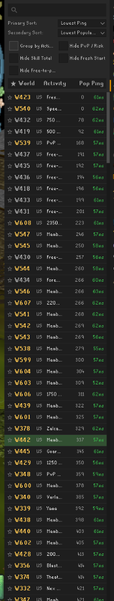
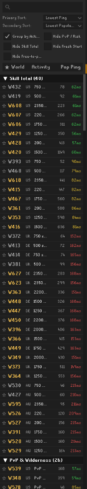
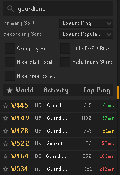

# Advanced World Switcher

A powerful world switching plugin for [RuneLite](https://runelite.net) featuring multi-order sorting, activity categorization, fast concurrent pinging with session persistence, and seamless quick-hopping.

---

## Screenshots

| Multi-Order Sorting | Activity Categorization | Live Search & Filtering |
|:---:|:---:|:---:|
|  |  |  |
| *Primary & secondary sort with ping threshold* | *Collapsible sections by game activity* | *Real-time search as you type* |

---

## Key Features

- **Multi-Order World Sorting:**
  - Set both a **Primary Sort** and a **Secondary Sort** (e.g., Primary: *Lowest Ping*, Secondary: *Lowest Population*).
  - Choose between *Lowest/Highest Ping*, *Lowest/Highest Population*, *World Number*, or *Activity Name*.
- **Smart Ping Threshold:**
  - Configurable tolerance (default `15ms`) where worlds with near-identical pings defer to the secondary sort (e.g. population), preventing ties from scattering servers.
- **Fast Concurrent Pinging & Persistence:**
  - Pings all worlds in parallel on startup using a dedicated worker pool (~1.5s total).
  - Ping measurements are cached directly to your RuneLite profile so every world displays its ping instantly on client launch.
- **Collapsible Activity Categories:**
  - Group worlds into clear, interactive section headers:
    - **Skill Total** (500, 750, 1250, 1500, 1750, 2000, 2200, 2350)
    - **Minigames** (Pest Control, Barbarian Assault, Wintertodt, Tempoross, GOTR, Soul Wars, etc.)
    - **Bossing & Raids** (Chambers of Xeric, Theatre of Blood, Tombs of Amascut, Nex, Corporeal Beast, Yama, etc.)
    - **PvP & Wilderness** (Bounty Hunter, PvP, High Risk, Target Worlds)
    - **Skilling & Training**
    - **Social & Trading**
    - **Quest Speedrunning**
    - **General / Regular Worlds**
- **Favorites:**
  - Click the star (★) beside any world to pin it into its own persistent section at the top of the list.
- **Live Search & Quick Filters:**
  - Search worlds in real time as you type (matches world number, activity, or region code).
  - Fast one-click checkbox filters:
    - *Hide PvP / High Risk*
    - *Hide Skill Total*
    - *Hide Fresh Start*
    - *Hide Free-to-play*
- **Quick Hopping:**
  - Click any world row to hop immediately (works seamlessly both in-game and from the login screen).
  - Current world is prominently highlighted with an active badge and custom green theme.

---

## Configuration

| Option | Default | Description |
|---|---|---|
| **Primary Sort** | `Lowest Ping` | First-priority sorting criterion for the world list. |
| **Secondary Sort** | `Lowest Population` | Secondary criterion applied when primary values tie or fall within the ping threshold. |
| **Ping Difference Threshold** | `15` ms | Worlds within this ping difference are considered equal, letting the secondary sort take precedence. |
| **Group by Activity** | `Enabled` | Organizes worlds under categorized collapsible headings. |
| **Hide PvP / High Risk** | `Disabled` | Hides PvP, High Risk, Bounty Hunter, and Deadman worlds. |
| **Hide Skill Total** | `Disabled` | Hides worlds requiring a specific total level. |
| **Hide Fresh Start** | `Disabled` | Hides Fresh Start worlds. |
| **Hide Free-to-play** | `Disabled` | Hides Free-to-play worlds. |

---

## Development & Testing

Run using the development launcher:
```powershell
.\run-dev.bat
```

Or build directly with Gradle:
```powershell
.\gradlew.bat run
```

---

## License

This project is licensed under the BSD 2-Clause License - see the [LICENSE](LICENSE) file for details.
